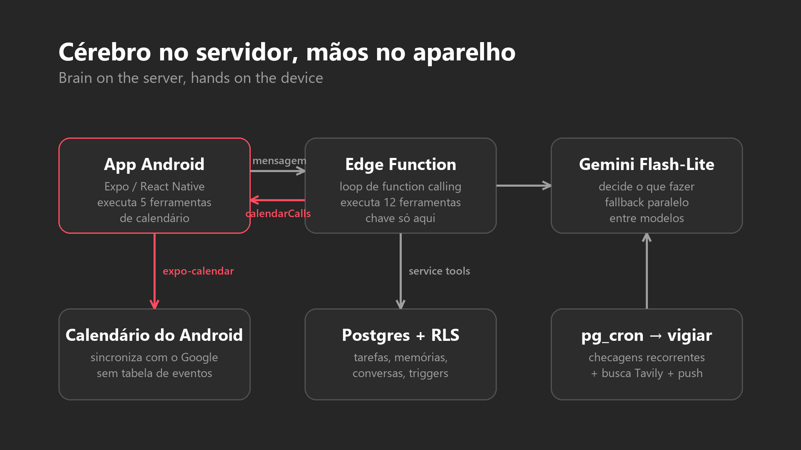

# Otto: case study

Assistente de agenda com IA para Android: você conversa, o assistente cria
eventos, tarefas, lembretes e checagens recorrentes. Este repositório tem
só o case study. **O código do app não é público.**

AI calendar assistant for Android: you chat, it creates events, tasks,
reminders and recurring checks. This repository holds the case study only.
**The app's source code is not public.**

▶️ **[Vídeo completo, 83 s](media/otto-demo.mp4)** · full video

## Leia / Read

- 🇧🇷 **[Artigo técnico em português](artigo.md)**: como estruturei o app, o que quebrou e o que eu mudaria.
- 🇺🇸 **[Technical article in English](article.md)**: how the app is structured, what broke and what I'd change.

## Em uma imagem / At a glance

| | |
| --- | --- |
| App | Expo / React Native, TypeScript |
| Agenda / Calendar | calendário do Android via `expo-calendar` (sem tabela de eventos / no events table) |
| Backend | Supabase: Postgres + RLS, Auth, Edge Functions, `pg_cron` |
| IA / AI | Gemini Flash-Lite e Flash, só no servidor / server-side only |
| Nativo / Native | módulo Kotlin próprio: alarmes, lembretes com ação, widgets / custom Kotlin module |
| Período / Timeline | 17/09 a 20/10/2026, 34 commits |

## Destaques / Highlights

- **Cérebro no servidor, mãos no aparelho.** O loop de function calling
  roda numa Edge Function; as 5 ferramentas de calendário voltam para o app
  executar no calendário do Android. / *The function-calling loop runs on
  the server; the 5 calendar tools are sent back to the device to run.*
- **Hedged requests** entre modelos quando o Gemini fica sobrecarregado:
  um pedido de 2 min 15 s; depois da correção, 23 s num pico de sobrecarga. /
  *across models when Gemini is overloaded: one request took 2 min 15 s; after the fix, 23 s during an overload.*
- **Os bugs de verdade foram de tempo:** dia inteiro em UTC, datas copiadas
  do histórico, tarefa recorrente que se multiplicava. / *The real bugs were
  about time: all-day events in UTC, dates copied from history, a recurring
  task that multiplied.*
