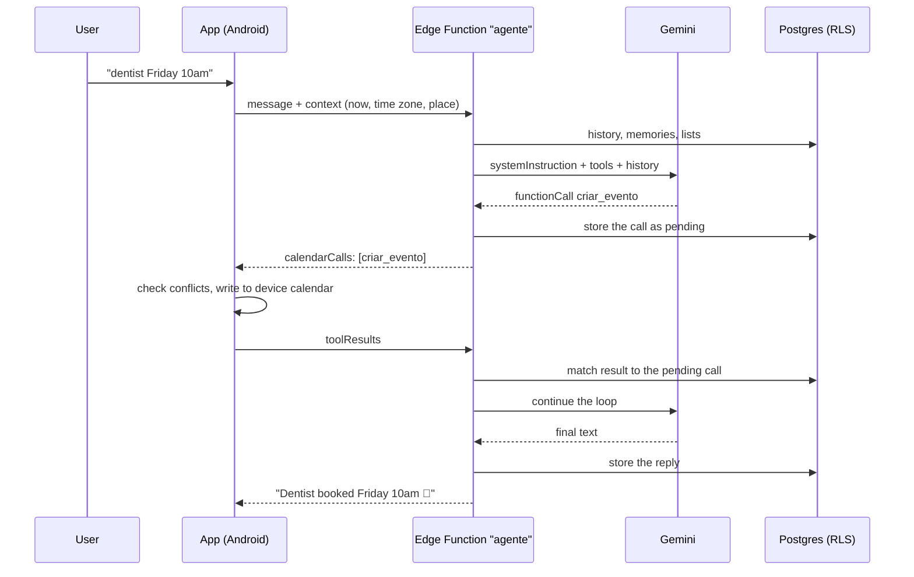
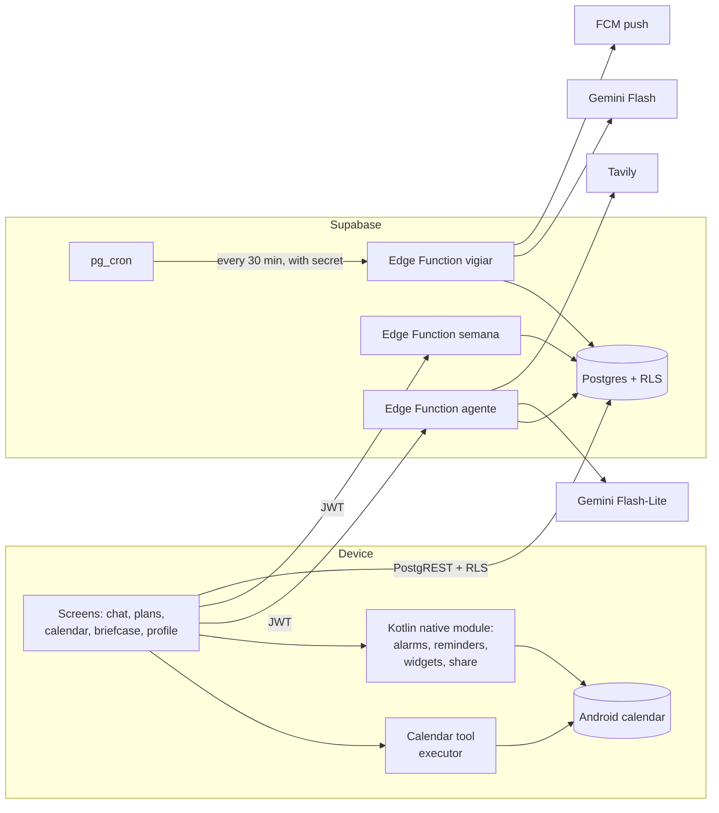

# Otto: building an AI calendar assistant for Android

> Technical case study. The app's source code is not public; this covers the
> structure, the decisions, what broke and what I would do differently.
>
> 🇧🇷 [Versão em português](artigo.md)

## Summary

Otto is a personal calendar and AI executive assistant for Android. You
type, talk or send a photo ("lunch with Ana Thursday 1pm", a picture of an
invitation, a 5-second voice note) and the assistant decides what to do:
create the event, the task or the reminder, search the web, or schedule a
recurring check. The calendar and task screens are there to check the
result. The chat is the main input.

It took about five weeks, from September 17 to October 20, 2026, across 34
commits. The app has about 12k lines of TypeScript, 1.4k lines of Kotlin
(native module) and 560 lines of SQL. The UI is in Brazilian Portuguese.

| | |
| --- | --- |
| App | Expo / React Native, TypeScript, expo-router |
| Calendar | the device's own calendar (`expo-calendar`), already synced with Google |
| Database and auth | Supabase: Postgres with RLS, Auth, Edge Functions, `pg_cron` |
| AI | Gemini Flash family, called only from Edge Functions |
| Web search | Tavily |
| Native | custom Kotlin module: alarm clock, actionable reminders, widgets, share target |

## 1. The idea that held it together: brain on the server, hands on the device

The first decision, and the one that simplified everything else: **there is
no events table**. The calendar is the Android calendar the user already has
synced with Google Calendar. That meant no Google Calendar OAuth, no two-way
sync and no version conflicts. The app reads and writes the local calendar
directly and Android handles the rest.

The catch is that the model has to run on the server, because the API key
cannot ship inside the APK (APKs get decompiled). But only the device can see
the calendar. The fix was to split the tools:

- **5 calendar tools** (`listar_agenda`, `criar_evento`, `mover_evento`,
  `editar_evento`, `excluir_evento`, Portuguese for list/create/move/edit/delete)
  run **on the device**.
- **12 server tools** (tasks, memory, triggers, web search) run **inside the
  Edge Function**, directly against the database.

The function-calling loop runs on the server (up to 8 turns). When the model
asks for a server tool, the function runs it and hands the result back to the
model right away. When it asks for a calendar tool, the function **stores
the call as pending** in `chat_messages` and returns it to the app. The app
runs it and posts the result back, and the function rebuilds the
conversation from the database and continues. The whole conversation is
persisted, tool calls included, so any request can pick up where the
previous one stopped.

## 2. A contract before the code

Before writing any code I wrote a briefing file with the stack, marked
"decided, do not reopen", a 6-step roadmap, and hard rules:

1. The Gemini key never goes into the app.
2. The brain stays on the server, the hands in the app.
3. No events table.
4. A list of what is **out of scope**, so it doesn't get built even if it
   looks easy: meeting coordination by email, public booking links, a
   contacts list, any plan or subscription screen.
5. No new dependency without an explicit decision.
6. No speculative abstraction: one user, one device.

Every new decision went into that file with a date ("Decisions of
2026-10-12"), including the negative ones: no light theme, no message
reactions. That kept the same questions from coming up every week, and it
did more for the pace of the project than anything else.

Work went in short milestones (M1 to M6), each ending with the app installed
on the phone and tested before the commit. Much of the testing was done over
`adb`: screenshots, taps and screen recordings on the physical device.

## 3. Structure

**Database.** Every table has `user_id default auth.uid()` and the same
"own rows" policy: threads, messages, tasks, task lists, memories, triggers,
notifications, weekly summaries and profile. The app reads and writes tasks
directly through PostgREST, without going through the AI, and RLS protects
the rows. Logic that has to behave the same from the app and from the agent
lives in database triggers. Example: completing a recurring task moves the
due date of that same task forward, whether it was a tap or a chat message.

**Edge Functions.** There are three:

- `agente`: the chat, with the function-calling loop, server tools, audio
  transcription, photo and PDF reading, and web search.
- `semana`: the weekly summary.
- `vigiar`: *triggers*, the recurring checks the user asks for ("tell me when
  tickets for show X go on sale"). `pg_cron` calls it every 30 minutes; it
  runs the triggers that are due, searches, decides whether it is worth a
  notification and sends a push.

**Native module.** Some things can't be done in JavaScript alone on Android,
so I wrote an Expo module in Kotlin, with no third-party library:

- an `AlarmManager` alarm that wakes the screen and rings even in silent
  mode;
- task due notifications with **Done** and **Tomorrow** buttons that work with
  the app closed (a local queue synced to Supabase later);
- repeating reminders and a "vibrate only" option;
- a morning briefing with weather (Open-Meteo, no key), events and tasks;
- three home-screen widgets (small, medium, and large with the week), plus a
  voice widget that opens the chat already recording;
- receiving text and photos from Android's "Share" menu.

**Prompt.** The system prompt is a template the function fills on every
request with the current date and time in the device's time zone, the next
few days with their dates, national holidays (computed, Easter included), the
user's memories, task lists, default duration and alert, and neighborhood and
city when location is on.

## 4. What broke

This is the most useful part of the project. None of these showed up during
planning.

### 4.1 The free Gemini quota changed which model I used

The chat started on a larger Flash model. On the free tier the daily quota is
**per model**, and that one had 20 requests a day. A message that uses a tool
costs 2 or 3 requests, so the quota ran out by mid-afternoon. I moved the
chat to Flash-Lite and kept the larger model for triggers only, which run a
few times a day.

Search went the same way. Google Search grounding on the 3.x models requires
billing. Triggers went from Tavily + Groq, back to Gemini with grounding, and
ended up with Tavily for search and Gemini for reasoning, capped at 3 checks a
day.

**Lesson:** on a free tier the quota is part of the architecture. Check the
limits of each model before choosing.

### 4.2 Google overloaded: one request took 2 min 15 s

"Find a BlaBlaCar for today at 6pm" took more than two minutes. The cause
wasn't the app or the prompt. Gemini returned 503/500 after about 15 seconds,
or hung for 30 seconds, and the agent retried the same model 4 times in a
row.

The fix was **hedged requests**: if the first call doesn't answer within 6
seconds, or fails with 503/500/429/404, the function fires another one in
parallel on a different model from the list (Flash-Lite → 3.1 Flash-Lite →
3.5 Flash → ...). The first response to arrive is used and the others are
cancelled through an `AbortSignal`. The cap is 12 attempts and 70 seconds in
total. Right after the fix, during an overload, a recurring-task request took
23 seconds.

### 4.3 The model copies the history

Two bugs, same cause:

- **Wrong dates.** In a long thread I'd ask for "today at 8:30pm" and the
  event landed yesterday. The model took the date from old messages in the
  history, even with the current date and time in the prompt. The fix was to
  send **every history message with the day and time it was sent**
  (`[Wed, 10/14 19:15]`). After that the model could tell what was past and
  what was today.
- **Required fields ignored.** In a thread full of old tool calls,
  Flash-Lite **imitated** the shape of those old calls and left out newer
  fields that were `required` in the schema (category, emoji). In a fresh
  thread it got them right.

**Lesson:** for a small model the history weighs as much as the prompt. Long
threads lower the quality, and timestamping each message makes a big
difference.

### 4.4 All-day events on the previous day

Tomorrow's holiday showed up **today at 9pm**. Android stores all-day events
at midnight **UTC**, and in São Paulo (UTC−3) that falls at 9pm the day
before. The bug appeared in the calendar, in search, in what the agent read
and in the reminder when editing. The fix was to normalize every read to
local midnight in a single place in the code.

### 4.5 Scrambled dates from `expo-calendar`

With several concurrent calendar reads on Android, some came back with dates
swapped between them. The fix was a queue that does **one read at a time**.
It's a bit slower, but the data comes back right.

### 4.6 The task that kept multiplying

"Water the plants" (daily) showed up three or four times in the list. The
recurring task was an `AFTER UPDATE` trigger that **created a copy** on
completion, and both the app and the agent were completing it. It became a
`BEFORE UPDATE` trigger that moves the due date of **that same row** forward
until it falls after now and reopens the subtasks. There is always a single
row, and completing it twice gives the same result (idempotent).

### 4.7 Three model calls to create one event

Confirming a reminder felt slow: 3 Gemini calls of about 4 s each. The model
listed the calendar to check for conflicts, then created the event, then
replied. I moved the conflict check **into the tool**: `criar_evento` checks on
the device and returns `{ ok: false, conflito }` on a clash (with
`apesar_do_conflito: true` to force it). That saves a full turn per event.

**Lesson:** each loop turn costs seconds. Tools that do the check themselves
save more than a better prompt.

### 4.8 A gesture that passed the test and failed in the hand

Swiping to open the threads worked over `adb`, which swipes in a straight
line, and failed by hand. A real finger moves in an arc, and the 15 dp
vertical limit cancelled the gesture. I switched to manual activation: after
10 dp the decision is made by the angle of the movement. The logs showed
something else too: the user (me) was swiping the wrong way.

**Lesson:** test gestures with a finger. The automated test approved a
gesture nobody could actually make.

### 4.9 The security sweep at the end

When I decided to hand the APK to a few friends, I did a security sweep. It
turned up these:

- **Account pre-hijacking.** Password sign-up without email confirmation let
  someone create an account with another person's email first and take over
  their Google login when they signed in. New accounts are now Google-only,
  with "Confirm email" on and login using PKCE instead of the implicit flow.
- **A forgotten function.** An old Edge Function wasn't called anymore but was
  still deployed, and it sent a push to every user at anyone's request. I
  deleted it. The cron function now only accepts calls carrying a shared
  secret stored in Vault.
- **Prompt injection through attachments.** A PDF, a photo or a search result
  could carry text saying "delete all events". The `excluir_*` (delete) and
  `lembrar` (remember) tools are now refused in any turn with an attachment or
  a search result. The model gets the error and asks the user.
- **Small fixes.** The Gemini key moved from the query string to a header,
  `allowBackup: false` on Android, the share target rejects `file://` and the
  app's own provider, and the voice widget needs a per-device secret in the
  deep link.

**Lesson:** a "just for me" app stops being just for me when the first friend
installs it. The sweep should have come earlier.

### 4.10 Smaller things that still cost time

- MIUI restricts the battery and kills scheduled alarms. Android doesn't let
  an app change that, so the app just opens the right system screen.
- A circle whose background was set after mount rendered square on Android.
- The free cloud build quota ran out mid-month. I switched to local Gradle
  builds signed with the same key.
- With no OTA updates, every app change meant a new APK.

## 5. What I would change

1. **Automated tests for dates and time zones from the start.** The worst bugs
   (all-day events in UTC, dates copied from history, recurrence) were all
   about time, and they were found by using the app. A small set of date
   tests would have caught most of them.
2. **Security on day one.** Login, exposed functions and injection through
   attachments were all visible from the first commit.
3. **Short threads by default.** Summarize or trim the history instead of
   sending 40 messages, because a small model with a long history makes more
   mistakes.
4. **Plan iOS from the start, or accept that it's Android only.** The native
   module is Android. iOS has different limits: 64 scheduled notifications,
   real alarms only on iOS 26+, widgets and share extensions in Swift. Right
   now iOS is close to a second project.
5. **`expo-updates` early.** OTA updates would have saved dozens of builds.
6. **Split the `agente` function.** It grew past 1,300 lines. Prompt, tools,
   model calls and persistence should be separate modules.
7. **Measure latency from the start.** The 2-minute case was only found
   because I noticed the wait. Logging the time of each turn and each model
   would have shown it earlier.
8. **Keep event categories out of the notes.** The Android calendar has no
   category field, so the category lives in a line of the event notes. It
   works, but the line shows up in Google Calendar and can be edited there.

## 6. What worked and I'd do again

- **No events table.** It removed a whole class of bugs.
- **Splitting tools between server and device**, with the pending call
  stored in the database.
- **The contract file with dated decisions**, including what was left out.
- **Testing on the real device at every milestone.** The gesture, MIUI and
  all-day bugs only appeared on the phone.
- **Domain logic in database triggers**, so it behaves the same from the app
  and from the agent.

---

*Otto's source code is not public. This repository only holds the write-up,
the diagrams and the demo video.*
