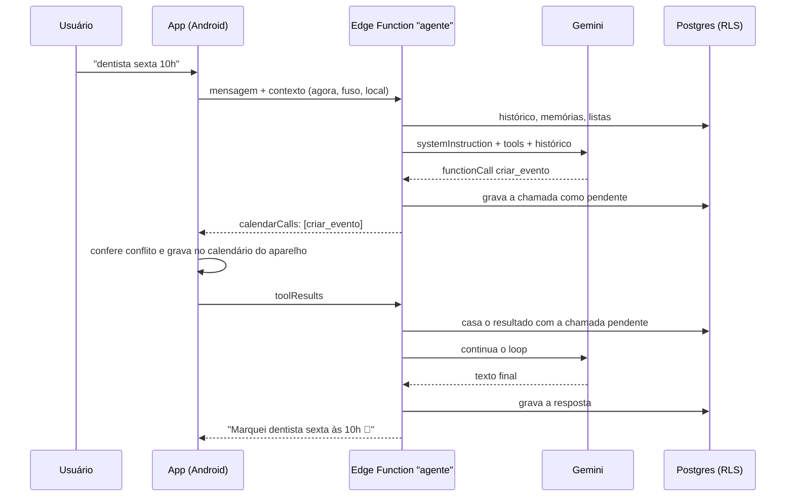
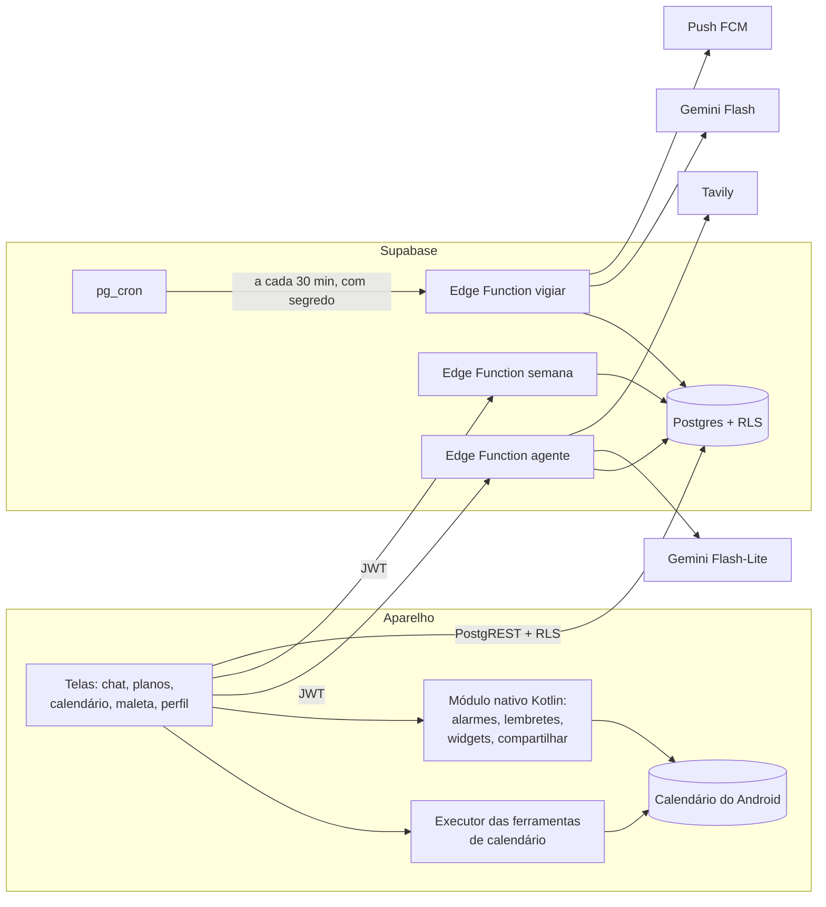

# Otto: como montei um assistente de agenda com IA para Android

> Case study técnico. O código do app não é público; aqui estão a estrutura,
> as decisões, o que quebrou e o que eu faria diferente.
>
> 🇺🇸 [English version](article.md)

## Resumo

O Otto é um app de calendário e assistente executivo de IA, de uso pessoal,
para Android. Você escreve, fala ou manda uma foto ("almoço com a Ana
quinta 13h", a foto de um convite, um áudio de 5 segundos) e o assistente
decide o que fazer: cria o evento, a tarefa, o lembrete, pesquisa na web ou
agenda uma checagem recorrente. As telas de calendário e de tarefas existem
para conferir o resultado. A entrada principal é o chat.

Foram cerca de cinco semanas, de 17 de setembro a 20 de outubro de 2026, com
34 commits. O app tem cerca de 12 mil linhas de TypeScript, 1.400 de Kotlin
(módulo nativo) e 560 de SQL.

| | |
| --- | --- |
| App | Expo / React Native, TypeScript, expo-router |
| Agenda | calendário do próprio aparelho (`expo-calendar`), que já sincroniza com o Google |
| Banco e login | Supabase: Postgres com RLS, Auth, Edge Functions, `pg_cron` |
| IA | Gemini da linha Flash, chamado só de dentro de Edge Functions |
| Busca na web | Tavily |
| Nativo | módulo Kotlin próprio: despertador, lembretes com ação, widgets, compartilhar |

## 1. A ideia que segurou o projeto: cérebro no servidor, mãos no aparelho

A primeira decisão, e a que mais simplificou o resto: **não existe tabela de
eventos**. A agenda é o calendário do Android, que o usuário já tem
sincronizado com o Google Calendar. Assim não precisei de OAuth do Google
Calendar, de sincronização bidirecional nem de conflito de versão. O app lê e
grava direto no calendário local e o Android cuida do resto.

O problema é que o modelo de IA precisa rodar no servidor, porque a chave da
API não pode ir dentro do APK (APK se descompila). E quem enxerga o
calendário é o aparelho. A solução foi dividir as ferramentas:

- **5 ferramentas de calendário** (`listar_agenda`, `criar_evento`,
  `mover_evento`, `editar_evento`, `excluir_evento`) são executadas **pelo
  app**.
- **12 ferramentas de servidor** (tarefas, memória, triggers, busca na web)
  são executadas **pela Edge Function**, direto no banco.

O loop de function calling roda no servidor (até 8 rodadas). Quando o modelo
pede uma ferramenta de servidor, a função executa e devolve o resultado ao
modelo na hora. Quando pede uma de calendário, a função **grava a chamada
como pendente** em `chat_messages` e devolve ao app. O app executa, manda o
resultado de volta, e a função remonta a conversa a partir do banco e segue.
A conversa inteira, incluindo as chamadas de ferramenta, fica salva, então
qualquer requisição consegue continuar de onde a outra parou.

## 2. Um contrato antes do código

Antes de escrever código, escrevi um arquivo de briefing com a stack
decidida ("não reabrir"), um roteiro em 6 passos e regras invioláveis:

1. A chave do Gemini nunca entra no app.
2. O cérebro fica no servidor, as mãos no app.
3. Nada de tabela de eventos.
4. Uma lista do que está **fora de escopo**, para não construir mesmo que pareça
   fácil: coordenação de reunião por e-mail, link público de agendamento,
   lista de contatos, tela de plano ou assinatura.
5. Nenhuma dependência nova sem decidir explicitamente.
6. Sem abstração especulativa: um usuário, um aparelho.

Cada decisão nova entrava nesse arquivo com data ("Decisões de 2026-10-12"),
inclusive as negativas: tema claro ficou fora, reação a mensagem ficou fora.
Isso evitou rediscutir a mesma coisa toda semana, e foi o que mais ajudou a
manter o ritmo.

O processo foi em milestones curtos (M1 a M6), cada um terminando com o app
instalado no celular e testado de verdade antes do commit. Boa parte dos
testes foi feita pelo `adb`: captura de tela, toques e gravação de tela no
aparelho físico.

## 3. Estrutura

**Banco.** Tabelas com `user_id default auth.uid()` e a mesma policy "own
rows" em todas: conversas, mensagens, tarefas, listas de tarefas, memórias,
triggers, notificações, resumos semanais e perfil. O app lê e grava tarefas
direto pelo PostgREST, sem passar pela IA, e a RLS protege as linhas. A
lógica que tem que valer tanto pelo app quanto pelo agente fica em trigger do
banco. Exemplo: concluir uma tarefa recorrente avança o prazo da própria
tarefa, seja pelo toque na tela ou pelo chat.

**Edge Functions.** São três:

- `agente`: o chat, com o loop de function calling, as ferramentas de
  servidor, transcrição de áudio, leitura de foto e PDF, e a busca na web.
- `semana`: o resumo da semana.
- `vigiar`: os *triggers*, checagens recorrentes que o usuário pede ("me
  avisa se sair ingresso para o show X"). O `pg_cron` chama a função a cada
  30 minutos e ela roda os triggers vencidos, pesquisa, decide se vale avisar
  e manda push.

**Módulo nativo.** Algumas coisas não dá para fazer só em JavaScript no
Android, então escrevi um módulo Expo em Kotlin, sem biblioteca de terceiros:

- despertador com `AlarmManager` que acende a tela e toca mesmo no modo
  silencioso;
- aviso de prazo de tarefa com botões **Concluir** e **Amanhã** que funcionam
  com o app fechado (fila local sincronizada com o Supabase depois);
- lembrete insistente e opção "só vibrar";
- resumo da manhã com clima (Open-Meteo, sem chave), eventos e tarefas;
- três widgets (pequeno, médio e grande com a semana) e um widget de voz que
  abre o chat já gravando;
- receber texto e foto pelo menu "Compartilhar" do Android.

**Prompt.** O *system prompt* é um template que a função preenche a cada
requisição com a data e hora atuais no fuso do aparelho, os próximos dias já
com data, feriados nacionais (calculados, incluindo a Páscoa), memórias do
usuário, listas de tarefas, padrões de duração e alerta, e o bairro e a
cidade quando a localização está ligada.

## 4. O que quebrou

Esta é a parte mais útil do projeto. Nenhum destes problemas apareceu no
planejamento.

### 4.1 A cota grátis do Gemini mudou a escolha do modelo

O chat começou num modelo Flash maior. No plano grátis, a cota diária é **por
modelo**, e esse modelo tinha 20 requisições por dia. Uma pergunta que usa
ferramenta gasta 2 ou 3 requisições, então a cota acabava no meio da tarde.
Passei o chat para o Flash-Lite e deixei o modelo maior só para os triggers,
que rodam poucas vezes por dia.

Algo parecido aconteceu com a busca. O *grounding* com Google Search nos
modelos 3.x exige billing. Os triggers passaram por Tavily + Groq, voltaram ao
Gemini com grounding e terminaram com Tavily como busca e Gemini como
cérebro, com no máximo 3 checagens por dia.

**Lição:** no plano grátis, a cota faz parte da arquitetura. Vale ver os
limites de cada modelo antes de escolher.

### 4.2 O Google sobrecarregado: um pedido levou 2 min 15 s

"Achar BlaBlaCar para hoje às 18h" levou mais de dois minutos. A causa não era
o app nem o prompt. O Gemini devolvia 503/500 depois de uns 15 segundos ou
travava 30 segundos sem responder, e o agente tentava o mesmo modelo 4 vezes
seguidas.

A correção foi fazer **hedged requests**: se a primeira chamada não responde
em 6 segundos, ou falha com 503/500/429/404, a função dispara outra em
paralelo, num modelo diferente da lista (Flash-Lite → 3.1 Flash-Lite → 3.5
Flash → ...). A primeira resposta que chegar é usada e as outras são
canceladas por `AbortSignal`. O limite é de 12 tentativas e 70 segundos no
total. Logo depois da correção, num momento de sobrecarga, um pedido de
tarefa recorrente levou 23 segundos.

### 4.3 O modelo copia o histórico

Dois problemas tinham a mesma causa:

- **Datas erradas.** Numa conversa longa, eu pedia "hoje às 20:30" e o evento
  ia para ontem. O modelo pegava a data de mensagens antigas do histórico,
  mesmo com a data e hora atuais no prompt. A correção foi mandar **cada
  mensagem do histórico com o dia e a hora em que foi enviada**
  (`[qua., 14/10 19:15]`). Com isso o modelo passou a distinguir o que é
  passado do que é hoje.
- **Campos obrigatórios ignorados.** Numa conversa com muitas chamadas
  antigas, o Flash-Lite **imitava** o formato das chamadas antigas e omitia
  campos novos que eram `required` no schema (categoria, emoji). Numa
  conversa nova vinha certo.

**Lição:** para um modelo pequeno, o histórico pesa tanto quanto o prompt.
Conversas longas pioram a qualidade, e marcar o tempo de cada mensagem tem um
efeito grande.

### 4.4 Evento de dia inteiro no dia anterior

O feriado de amanhã aparecia **hoje às 21:00**. O Android guarda evento de dia
inteiro à meia-noite **UTC**, e em São Paulo (UTC−3) isso cai às 21:00 do dia
anterior. O bug aparecia no calendário, na busca, no que o agente lia e no
lembrete ao editar. A correção foi normalizar toda leitura para meia-noite
local, num único ponto do código.

### 4.5 Datas embaralhadas no `expo-calendar`

Com várias leituras do calendário ao mesmo tempo no Android, algumas voltavam
com datas trocadas entre si. A correção foi uma fila que faz **uma leitura de
cada vez**. Fica um pouco mais lento, mas os dados vêm certos.

### 4.6 A tarefa que se multiplicava

"Regar plantas" (diária) aparecia três, quatro vezes na lista. A tarefa
recorrente era um trigger `AFTER UPDATE` que **criava uma cópia** ao concluir,
e tanto o app quanto o agente concluíam. Passou a ser `BEFORE UPDATE`
avançando o prazo **da própria linha** até cair depois de agora e reabrindo as
subtarefas. Assim existe sempre uma linha só, e concluir duas vezes dá o
mesmo resultado (idempotente).

### 4.7 Três idas ao modelo para criar um evento

Confirmar um lembrete parecia lento: eram 3 chamadas ao Gemini de uns 4 s
cada. O modelo listava a agenda para checar conflito, depois criava, depois
respondia. Passei a checagem de conflito **para dentro da ferramenta**:
`criar_evento` confere no aparelho e devolve `{ ok: false, conflito }` se
houver choque (com `apesar_do_conflito: true` para forçar). Isso economiza
uma rodada inteira por evento.

**Lição:** cada rodada do loop custa segundos. Ferramentas que já fazem a
checagem economizam mais do que um prompt melhor.

### 4.8 Gesto que funcionava no teste e não no dedo

Deslizar para abrir as conversas funcionava no `adb`, que desliza em linha
reta, e falhava na mão. O dedo real faz um arco, e o limite vertical de 15 dp
cancelava o gesto. Troquei por ativação manual: depois de 10 dp a decisão é
feita pelo ângulo do movimento. Os logs mostraram outra coisa: o usuário (eu)
estava deslizando para o lado errado.

**Lição:** gesto se testa com o dedo. O teste automatizado aprovou um gesto
que ninguém consegue fazer.

### 4.9 A varredura de segurança no fim

Quando decidi passar o APK para alguns amigos testarem, fiz uma varredura de
segurança. Achei estes problemas:

- **Tomada de conta antes do cadastro.** O cadastro por senha sem confirmação
  de e-mail deixava alguém criar antes uma conta com o e-mail de outra pessoa
  e ficar com o login Google dela quando ela entrasse. Agora conta nova é só
  pelo Google, com "Confirm email" ligado e login em PKCE em vez do fluxo
  implícito.
- **Função esquecida.** Uma Edge Function antiga não era mais chamada, mas
  continuava no ar e mandava push para todos os usuários a pedido de qualquer
  um. Apaguei. A função do cron agora só aceita a chamada com um segredo
  compartilhado guardado no Vault.
- **Prompt injection por anexo.** Um PDF, uma foto ou um resultado de busca
  podia trazer texto mandando "apague todos os eventos". As ferramentas
  `excluir_*` e `lembrar` passaram a ser recusadas numa rodada que tem anexo ou
  resultado de busca. O modelo recebe o erro e pergunta ao usuário.
- **Miúdos.** A chave do Gemini saiu da query string e foi para header,
  `allowBackup: false` no Android, o compartilhamento recusa `file://` e o
  provedor do próprio app, e o widget de voz exige um segredo do aparelho no
  deep link.

**Lição:** um app "só para mim" deixa de ser só para mim quando o primeiro
amigo instala. A varredura deveria ter vindo antes.

### 4.10 Menores, mas que custaram tempo

- O MIUI restringe a bateria e mata alarmes agendados. O Android não deixa
  liberar isso por código, então o app só abre a tela certa do sistema.
- Um círculo com fundo aplicado depois do *mount* saía quadrado no Android.
- A cota grátis de builds na nuvem acabou no meio do mês. Passei a compilar
  localmente com Gradle, assinando com a mesma chave.
- Sem atualização OTA, toda mudança no app exigia um APK novo.

## 5. O que eu mudaria

1. **Testes automáticos para datas e fuso desde o início.** Os piores bugs
   (dia inteiro em UTC, data copiada do histórico, recorrência) eram todos de
   tempo e foram achados usando o app. Um conjunto pequeno de testes de datas
   teria pegado a maioria.
2. **Segurança no primeiro dia.** Login, funções expostas e injeção por
   anexo: tudo isso estava visível desde o primeiro commit.
3. **Conversas curtas por padrão.** Resumir ou cortar o histórico em vez de
   mandar 40 mensagens, porque modelo pequeno com histórico longo erra mais.
4. **Planejar o iOS desde o começo, ou assumir que é só Android.** O módulo
   nativo é Android. No iOS os limites são outros: 64 notificações agendadas,
   alarme de verdade só no iOS 26+, widgets e compartilhar em Swift. Hoje o
   iOS é praticamente um segundo projeto.
5. **`expo-updates` cedo.** Atualização OTA teria economizado dezenas de
   builds.
6. **Separar a função `agente`.** Ela passou de 1.300 linhas. Prompt,
   ferramentas, chamada ao modelo e persistência deviam ser módulos
   separados.
7. **Medir a latência desde o início.** O caso dos 2 minutos só foi
   descoberto porque eu notei a demora. Registrar o tempo de cada rodada e de
   cada modelo teria mostrado isso antes.
8. **Categoria do evento fora das notas.** O calendário do Android não tem
   campo para categoria, então ela fica numa linha das notas do evento. Isso
   funciona, mas a linha aparece no Google Calendar e pode ser editada por lá.

## 6. O que deu certo e eu repetiria

- **Não ter tabela de eventos.** Eliminou uma categoria inteira de bugs.
- **Dividir as ferramentas entre servidor e aparelho**, com a chamada
  pendente salva no banco.
- **O arquivo de contrato com decisões datadas**, inclusive o que ficou de
  fora.
- **Testar no aparelho real a cada milestone.** Os bugs de gesto, de MIUI e
  de dia inteiro só apareciam no celular.
- **Lógica de domínio em trigger do banco**, para valer igual pelo app e pelo
  agente.

---

*O código-fonte do Otto não é público. Este repositório tem só o texto, os
diagramas e o vídeo de demonstração.*
